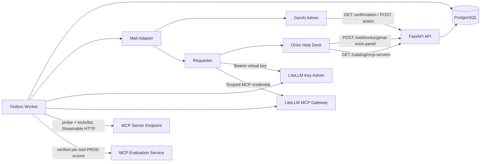
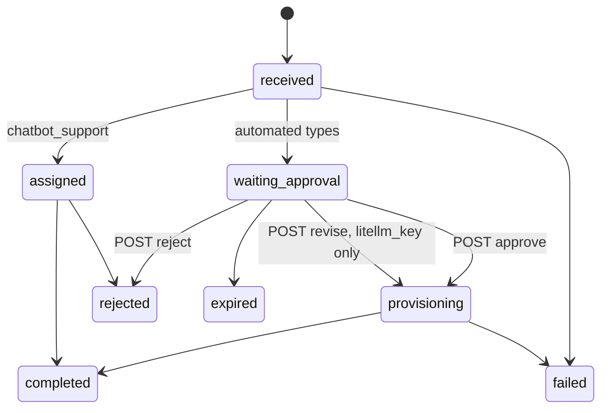
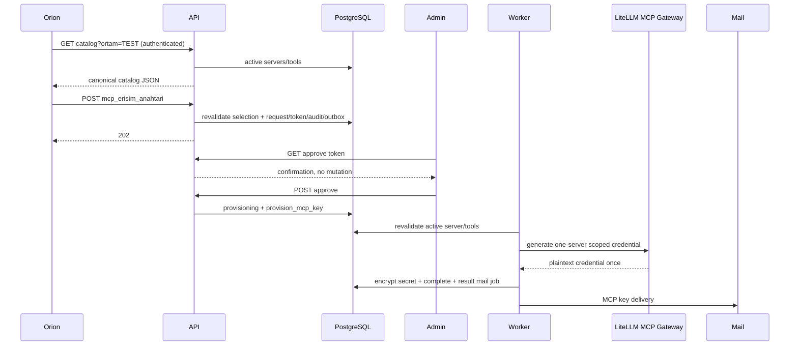
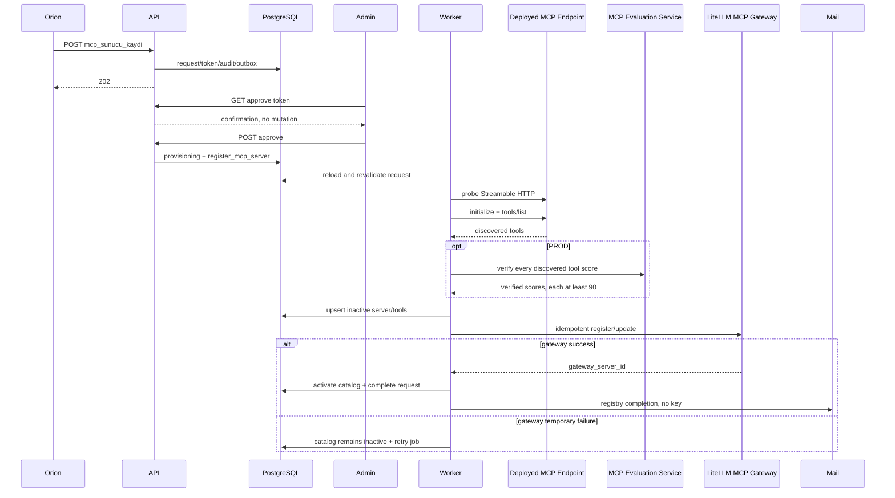

# Orion GenAI Requests — Yetkili Teknik Baseline

**Status:** Uygulama için bağlayıcı teknik tasarım; application code henüz yok  
**Authority:** Bu dosya projenin tek implementation truth / ground truth dokümanıdır.  
**Runtime:** Python 3.12+, FastAPI, PostgreSQL, `uv` workspace  
**Architecture:** modular monolith, hexagonal architecture, transactional outbox  
**Deployment:** tek image, ayrı API ve worker process

Orion JSON alan şekli: [genai-orion-panel-talep-key-contract.md](genai-orion-panel-talep-key-contract.md). Historical SDD, şema taslakları ve `docs/dev/` altındaki notlar bu dosyayı override edemez. Çelişkide bu baseline uygulanır.

---

## 1. Amaç, kapsam ve kapsam dışı işler

Backend, Atlassian Orion'dan dört internal request type alır:

1. `litellm_key`: LiteLLM virtual key talebi.
2. `mcp_key`: LiteLLM MCP Gateway üzerinden, tek MCP server ve seçili tool'lar için scoped credential talebi.
3. `mcp_server_registry`: önceden deploy edilmiş Streamable HTTP MCP endpoint'ini keşfedip katalog ve LiteLLM MCP Gateway'e kaydetme talebi.
4. `chatbot_support`: mevcut human support/assignment workflow'u.

Backend:

- Orion webhook'unu authenticate eder, canonical wire contract'a göre validate eder ve internal modele normalize eder.
- Request, audit, tek-kullanımlık approval token ve outbox job'larını atomik transaction ile yazar.
- Approval ve sonuç maillerini worker ile gönderir.
- Admin `Approve`, `Revise`, `Reject` action'larını signed token ile işler.
- Approved LiteLLM ve MCP key request'lerinde credential üretir, encrypted-at-rest saklar ve requester'a key-delivery maili gönderir.
- Approved registry request'inde endpoint'i tekrar validate/probe eder, tool discovery yapar, inactive catalog satırlarını upsert eder, gateway registration yapar ve ancak başarıdan sonra catalog'u active eder.
- Chatbot support request'ini human queue'ya assign eder; uzun süren chatbot işini process içinde çalıştırmaz.

MCP iki workflow ile kesin olarak scope içindedir. MCP provider, **LiteLLM MCP Gateway**'dir.

Registry workflow'unun yapmadıkları:

- repository oluşturmaz;
- Jira/DevOps task oluşturmaz;
- CI/CD pipeline veya Helm chart üretmez;
- MCP server deploy etmez;
- end-user MCP key üretmez;
- `secrets` tablosuna kayıt yazmaz.

Registry yalnız zaten deploy edilmiş endpoint'i kaydeder. Kapsam dışında kalanlar: Orion UI implementation, ayrı SPA/self-service portal, key rotation/lost-key recovery otomasyonu ve usage analytics dashboard.

---

## 2. Bağlayıcı kararlar

| ID | Karar |
| --- | --- |
| ADR-001 | `uv` workspace monorepo, tek lockfile |
| ADR-002 | Modular monolith ve hexagonal boundaries |
| ADR-003 | PostgreSQL transactional outbox; API external provider çağırmaz |
| ADR-004 | Tek image, API ve worker ayrı process |
| ADR-005 | LiteLLM key provider ve MCP provider adapter boundary içinde LiteLLM'dir |
| ADR-006 | MCP yalnız `TEST` ve `PROD`; MCP için `STG` yoktur |
| ADR-007 | MCP transport yalnız Streamable HTTP; SSE reddedilir |
| ADR-008 | Registry, catalog + gateway dual-write işlemini retryable saga olarak yürütür |
| ADR-009 | Requester TPM/RPM/token/organization girmez; organization sabit `ALZ` |
| ADR-010 | GET action endpoint'leri yalnız confirmation/form; mutasyon yalnız POST |
| ADR-011 | `Revise` yalnız `litellm_key` için geçerlidir; iki MCP tipi yalnız approve/reject destekler |
| ADR-012 | `docs/baseline.md` tek implementation authority'dir |

Redis ancak ölçülmüş ihtiyaçla eklenir. PostgreSQL request/config store ve durable queue'dur.

---

## 3. Sistem bağlamı



API ve worker aynı artifact'ten çalışır. External ağ çağrıları worker adapter'larından yapılır; catalog GET için API yalnız PostgreSQL okur.

---

## 4. Request type, Orion mapping ve sonuç türleri

### 4.1 Talep türü mapping

| Orion `talep_turu` | Internal `request_type` | Workflow |
| --- | --- | --- |
| `litellm_api_anahtari` | `litellm_key` | secret-producing |
| `mcp_erisim_anahtari` | `mcp_key` | secret-producing |
| `mcp_sunucu_kaydi` | `mcp_server_registry` | catalog-mutating, secret üretmez |
| external contract'ta belirlenecek chatbot değeri | `chatbot_support` | human assignment |

Webhook router bu explicit mapping dışında inference yapmaz. Bilinmeyen `talep_turu` `422 UNKNOWN_REQUEST_TYPE` döndürür. Idempotency identity `(genai_orion_panel_ticket_id, request_type)`'dır.

### 4.2 Type davranışı

| Type | Approval action | Provision sonucu |
| --- | --- | --- |
| `litellm_key` | approve / revise / reject | encrypted LiteLLM key |
| `mcp_key` | approve / reject | encrypted scoped MCP key |
| `mcp_server_registry` | approve / reject | active catalog + gateway registration; secret yok |
| `chatbot_support` | mevcut support kuralı | assignment/completion |

Credential yalnız `litellm_key` ve `mcp_key` için üretilir. Registry request'i `secrets` ile ilişkilendirilemez.

### 4.3 Chatbot support sınırı

`chatbot_support` human workflow olarak korunur fakat üç-form Orion handoff contract'ının parçası değildir. Exact chatbot `talep_turu` değeri ve Türkçe wire key'leri onaylanmış değildir; Bölüm 21'de external contract placeholder olarak kalır. Bu nedenle otomatik üç formun locked flat JSON contract'ına chatbot field'i eklenmez.

External mapper hazır olduğunda normalize edeceği internal field'lar:

| Internal field | Kural |
| --- | --- |
| `brief` | required, bounded long text |
| `channel_or_use_case` | optional text/normalized configured value |
| `priority` | optional configured internal priority |
| `target_date` | optional date |
| `assignee_email` | backend tarafından belirlenir; requester-controlled değildir |

Chatbot inbound doğrudan `assigned` status ile insert edilir. Assignee, active `config_approvers` chatbot pool'u veya `CHATBOT_ASSIGNEE_EMAILS` üzerinden normalize edilmiş ticket id hash'iyle deterministic round-robin seçilir; retry aynı assignee'yi üretir. Aynı transaction request, assignee, audit ve `send_assignment_mail` outbox job'ını yazar; approval token oluşturmaz. Attachment backend'e taşınmaz, Orion-native kalır ve mail/internal ekran ticket URL'sine yönlendirir.

---

## 5. Flat Orion webhook ve canonical wire contracts

Orion wire key'leri **Türkçe ASCII `snake_case`**'tir. Accent'li key, camelCase veya internal English key inbound contract değildir. Webhook JSON'u flat'tir: shared ve type-specific field'lar aynı top-level object içindedir; nested form payload'ı yoktur.

### 5.1 Her payload'daki shared field'lar

| Wire | Tip / kural | Internal |
| --- | --- | --- |
| `talep_turu` | required request type discriminator | explicit mapping üzerinden `request_type` |
| `talep_no` | required text | `genai_orion_panel_ticket_id` |
| `talep_url` | required URL | `genai_orion_panel_ticket_url` |
| `talep_eden_adi` | required text | `requester_name` |
| `talep_eden_eposta` | required email | `requester_email` |
| `olusturulma_tarihi` | required ISO-8601 timestamp | `genai_orion_panel_created_at` |

Bu shared key'lerden sonra type-specific key'ler aynı JSON seviyesinde gelir. Payload şeması kilitlidir ve external placeholder değildir. Requester identity custom form alanından alınmaz. Yalnız gerçek captured fixture'ın byte-level ayrıntıları ile webhook header/auth davranışı external doğrulama bekler.

### 5.2 LiteLLM key formu

| Wire alan | Tip / kural | Internal |
| --- | --- | --- |
| `departman_adi` | required text | `department_name` |
| `ortam` | `DEV\|STG\|PROD` | `environment` |
| `talep_aciklamasi` | required long text | `request_description` |
| `kullanim_amaci` | `RAG\|CHAT\|AGENT\|DIGERI` | `purpose_code` |
| `kullanim_senaryosu` | required long text | `use_case` |
| `modeller` | required non-empty unique array; aşağıdaki enum | `models` |
| `yanit_suresi` | required response-time enum | `response_window` |
| `kullanim_sikligi` | required frequency enum | `usage_frequency` |
| `tahmini_gunluk_istek` | optional positive integer | `estimated_daily_requests` |
| `maksimum_es_zamanli_istek` | integer `>=1` | `max_concurrent_requests` |
| `ortalama_girdi_sayfasi` | `1\|3\|5\|10` | `input_pages` |
| `ortalama_cikti_sayfasi` | `0.5\|1\|3` | `output_pages` |

Canonical teknik değerler ve kullanıcı etiketleri:

- `modeller`: `allianz-text` — Allianz Lingua; `allianz-vision` — Allianz Optix; `allianz-text-small` — Allianz Text Small; `allianz-coder` — Allianz Codia; `text2test` — Text2Test.
- `yanit_suresi`: `realtime` — Gerçek zamanlı; `within_1h` — 1 saat içinde; `by_17` — Aynı gün saat 17.00'ye kadar; `by_next_08` — Ertesi gün saat 08.00'e kadar.
- `kullanim_sikligi`: `0_10` — Günde 0–10 istek; `10_100` — Günde 10–100 istek; `100_1000` — Günde 100–1.000 istek; `1000_10k` — Günde 1.000–10.000 istek.
- `ortalama_girdi_sayfasi`: `1 | 3 | 5 | 10`.
- `ortalama_cikti_sayfasi`: `0.5 | 1 | 3`.

Inbound model değerleri yukarıdaki kapalı allowlist'e karşı doğrulanır ve boş liste reddedilir. Formda TPM, RPM, token count veya organization alanı yoktur. `organization = "ALZ"` backend sabitidir.

```json
{
  "talep_turu": "litellm_api_anahtari",
  "talep_no": "HD-12345",
  "talep_url": "https://atlassian.allianz/HD-12345",
  "talep_eden_adi": "Kubilay",
  "talep_eden_eposta": "user@allianz.com.tr",
  "olusturulma_tarihi": "2026-08-17T11:00:00+03:00",
  "departman_adi": "GENAI",
  "ortam": "PROD",
  "talep_aciklamasi": "LiteLLM API anahtarı talebi.",
  "kullanim_amaci": "RAG",
  "kullanim_senaryosu": "Kurumsal dokümanlardan soru cevaplama.",
  "modeller": ["allianz-text"],
  "yanit_suresi": "realtime",
  "kullanim_sikligi": "100_1000",
  "tahmini_gunluk_istek": 400,
  "maksimum_es_zamanli_istek": 5,
  "ortalama_girdi_sayfasi": 3,
  "ortalama_cikti_sayfasi": 1
}
```

Capacity hint:

```text
estimated_tokens_per_request = (input_pages + output_pages) * 1000
estimated_peak_rpm = max_concurrent_requests
estimated_peak_tpm = estimated_peak_rpm * estimated_tokens_per_request
```

Bu tahminler requester'ın provider limitini belirlemez; policy/admin `Revise` belirler.

### 5.3 MCP access key formu

| Wire alan | Tip / kural | Internal |
| --- | --- | --- |
| `departman_adi` | required text | `department_name` |
| `ortam` | `TEST\|PROD` | `environment` |
| `talep_aciklamasi` | required long text | `request_description` |
| `kullanim_amaci` | required long text | `purpose_text` |
| `mcp_sunucusu` | active catalog `server_name` | `mcp_server_slug` |
| `araclar` | conditional unique array | `mcp_tool_names` |
| `tum_araclara_erisim` | boolean, default `false` | `all_tools` |

Kurallar:

- Server bir veya birden fazla olabilir; her biri aynı `ortam` için catalog'da active bulunmalıdır.
- `all_tools=false` ise o sunucu için en az bir `araclar` değeri gerekir.
- `all_tools=true` ise o sunucunun `araclar` listesi boş olmalıdır.
- Inbound, UI catalog seçimine güvenmez; server/tool/all-tools privilege'ını transaction öncesinde yeniden validate eder.

```json
{
  "talep_turu": "mcp_erisim_anahtari",
  "talep_no": "HD-12346",
  "talep_url": "https://atlassian.allianz/HD-12346",
  "talep_eden_adi": "Kubilay",
  "talep_eden_eposta": "user@allianz.com.tr",
  "olusturulma_tarihi": "2026-08-17T11:05:00+03:00",
  "departman_adi": "GENAI",
  "ortam": "PROD",
  "talep_aciklamasi": "Ajan uygulaması için MCP erişimi.",
  "kullanim_amaci": "Kurumsal dokümanlarda arama.",
  "mcp_sunucusu": "document-search",
  "araclar": ["rag", "search"],
  "tum_araclara_erisim": false
}
```

### 5.4 MCP server registry formu

| Wire alan | Tip / kural | Internal |
| --- | --- | --- |
| `departman_adi` | required text | `department_name` |
| `mcp_sunucu_adi` | required display text | `mcp_server_display_name` |
| `proje_adi` | slug source, required | `project_name` ve normalized `server_slug` |
| `teknik_sorumlu_eposta` | required corporate email | `technical_owner_email` |
| `kullanim_amaci` | required long text | `purpose_text` |
| `repo_platformu` | `GITHUB\|BITBUCKET` | `repo_platform` |
| `repo_url` | required HTTPS URL | `repo_url` |
| `devops_jira_no` | optional | normalized `devops_jira_key` |
| `ortam` | `TEST\|PROD` | `environment` |
| `mcp_endpoint_url` | exact expected URL | `endpoint_url` |
| `minimum_evaluation_skoru` | PROD'da required integer `>=90`; TEST'te optional | `minimum_evaluation_score` |
| `ek_notlar` | optional text | `additional_notes` |

Endpoint canonical formatı:

- `TEST`: `https://test-mcp.allianz-tr.local/{proje_adi}/mcp`
- `PROD`: `https://mcp.allianz-tr.local/{proje_adi}/mcp`

`mcp_endpoint_url`, seçilen environment ve normalized `proje_adi` ile byte-for-byte canonical URL üretimine eşit olmalıdır; query, fragment, userinfo ve alternate port kabul edilmez. Transport yalnız Streamable HTTP'dir. SSE endpoint/content negotiation reddedilir.

```json
{
  "talep_turu": "mcp_sunucu_kaydi",
  "talep_no": "HD-12347",
  "talep_url": "https://atlassian.allianz/HD-12347",
  "talep_eden_adi": "Kubilay",
  "talep_eden_eposta": "user@allianz.com.tr",
  "olusturulma_tarihi": "2026-08-17T11:10:00+03:00",
  "departman_adi": "GENAI",
  "mcp_sunucu_adi": "Doküman Arama MCP",
  "proje_adi": "document-search",
  "teknik_sorumlu_eposta": "mcp-owner@allianz.com.tr",
  "kullanim_amaci": "Ajanların kurumsal dokümanlarda arama yapmasını sağlar.",
  "repo_platformu": "BITBUCKET",
  "repo_url": "https://sdlc.allianz.com.tr/stash/projects/ALLMCP/repos/document-search",
  "devops_jira_no": "ATL-12345",
  "ortam": "PROD",
  "mcp_endpoint_url": "https://mcp.allianz-tr.local/document-search/mcp",
  "minimum_evaluation_skoru": 94,
  "ek_notlar": "Release branch üzerinden Prod deployment tamamlandı."
}
```

### 5.5 Enum ve environment authority

DB shared `environment` enum'u `DEV | STG | TEST | PROD` içerebilir. Request validator ayrıca type matrix uygular:

| Request type | Geçerli ortam |
| --- | --- |
| `litellm_key` | `DEV`, `STG`, `PROD` |
| `mcp_key` | `TEST`, `PROD` |
| `mcp_server_registry` | `TEST`, `PROD` |

MCP için `STG` hiçbir alias/fallback ile kabul edilmez.

---

## 6. Naming ve uniqueness

### 6.1 LiteLLM alias

```text
ALZ-{DEPARTMENT}-{NORMALIZED_TICKET}-{ENVIRONMENT}-{PURPOSE}
```

Örnek: `ALZ-GENAI-HD12345-DEV-RAG`.

### 6.2 MCP key alias

```text
ALZ-MCP-{DEPARTMENT}-{NORMALIZED_TICKET}-{ENVIRONMENT}-{SERVER_SLUG}
```

Örnek: `ALZ-MCP-HASAR-HD22334-TEST-HASAR-BILGI`.

Alias normalizasyonu: uppercase, unsupported karakterleri `-`, duplicate separator collapse, baş/son separator trim. Alias deterministic ve provider limitine göre adapter config'inde bounded olmalıdır; truncate gerekiyorsa collision-safe kısa hash eklenir.

### 6.3 Registry slug ve ticket

- `proje_adi` lowercase ASCII slug'a normalize edilir: `^[a-z0-9]+(?:-[a-z0-9]+)*$`.
- `server_name` Orion-facing key'dir ve internal `slug` ile aynıdır.
- Registry uniqueness `(environment, slug)`'dır.
- Aynı slug TEST ve PROD'da bulunabilir; aynı environment'ta tek server row vardır.
- Aynı environment'ta aynı slug veya endpoint ile active kayıt varsa yeni registry talebi `409 MCP_SERVER_ALREADY_REGISTERED` ile reddedilir. Retry yalnız aynı `source_request_id` için idempotent devam eder; başka bir request active kaydı inactive hâle getiremez.
- `devops_jira_no` varsa trim + uppercase yapılır ve `^[A-Z][A-Z0-9]+-[1-9][0-9]*$` ile validate edilir.
- Orion ticket id trim + uppercase ile normalize edilir; raw değer ayrıca audit metadata'da tutulabilir.

---

## 7. Hedef monorepo ve modüller

```text
Allianz/
├── pyproject.toml
├── uv.lock
├── docs/baseline.md
├── apps/
│   ├── api/src/genai_orion_panel_api/
│   │   ├── main.py
│   │   ├── dependencies.py
│   │   ├── middleware/{correlation.py,webhook_auth.py,catalog_auth.py}
│   │   ├── routes/{health.py,genai_orion_panel_webhook.py,approval_actions.py,mcp_catalog.py,internal.py}
│   │   ├── schemas/{genai_orion_panel_webhook.py,litellm_key.py,mcp_key.py,mcp_registry.py,actions.py,catalog.py}
│   │   └── templates/{approve.html,revise.html,reject.html,action_result.html}
│   └── worker/src/genai_orion_panel_worker/
│       ├── main.py
│       ├── dispatcher.py
│       ├── handlers.py
│       └── heartbeat.py
├── packages/
│   ├── genai-orion-panel-core/src/genai_orion_panel_core/
│   │   ├── domain/
│   │   │   ├── entities/{request.py,approval_token.py,mcp_server.py,mcp_tool.py}
│   │   │   ├── value_objects/{naming.py,usage.py,identifiers.py,mcp_endpoint.py}
│   │   │   ├── enums.py
│   │   │   ├── errors.py
│   │   │   └── transitions.py
│   │   └── application/
│   │       ├── commands/{receive_genai_orion_panel_request.py,approve_request.py,revise_request.py,reject_request.py}
│   │       ├── jobs/{provision_litellm_key.py,provision_mcp_key.py,register_mcp_server.py,send_mail.py,expire_approvals.py}
│   │       ├── dto.py
│   │       └── ports/{unit_of_work.py,repositories.py,outbox.py,litellm.py,mcp.py,mail.py,crypto.py,clock.py}
│   └── genai-orion-panel-adapters/src/genai_orion_panel_adapters/
│       ├── config.py
│       ├── postgres/{engine.py,models.py,repositories.py,unit_of_work.py,outbox.py,mcp_catalog.py}
│       ├── litellm/{client.py,key_gateway.py,mcp_gateway.py,mcp_registry.py}
│       ├── mcp/{discovery.py,streamable_http.py,evaluation.py}
│       ├── mail/{placeholder.py,models.py,templates.py}
│       ├── crypto/{signer.py,cipher.py}
│       └── observability/{logging.py,metrics.py}
├── migrations/{env.py,versions/}
├── tests/
│   ├── unit/{domain,application}/
│   ├── contract/{orion,litellm,mcp_gateway,mcp_discovery,mcp_evaluation}/
│   ├── integration/{postgres,outbox,catalog}/
│   ├── e2e/{litellm_key,mcp_key,mcp_registry}/
│   └── architecture/
└── infra/{Dockerfile,compose.yaml,deployment/}
```

`genai-orion-panel-core` FastAPI, SQLAlchemy, httpx, Jinja veya environment import etmez. Adapter'lar core port'larını implement eder; `apps` yalnız composition/transport yapar. Tek `uv.lock` version-control edilir.

---

## 8. Domain model ve type-aware state machine

`Request` aggregate ortak identity/status alanlarıyla type-specific value'ları taşır. Alanlar typed nested detail veya nullable columns olabilir; her durumda request type invariant'ları domain/application validator'da zorlanır.

Ortak field'lar:

- request id/type/status/version;
- Orion ticket/requester identity;
- department, environment, description;
- alias/slug;
- approval/rejection/error/audit timestamps.

Type-specific field'lar:

- LiteLLM: purpose enum, use case, models, response/frequency/pages/concurrency, estimates ve approved limits.
- MCP key: purpose text, server slug, selected tools, `all_tools`.
- Registry: display/project/slug, owner, repository, Jira, endpoint, evaluation score, gateway sync state.
- Chatbot: `brief`, `channel_or_use_case`, `priority`, `target_date`, backend-resolved `assignee_email`.



`Revise` ayrı state değildir ve yalnız `litellm_key` için limit/policy formudur. LiteLLM estimate'leri advisory'dir ve admin confirmation'da gösterilir. Approve estimate'leri kabul eder; farklı limit için Revise kullanılır. `mcp_key` ve `mcp_server_registry` revise token/template/route dispatch'i üretmez; bu tiplerde revise attempt `409 ACTION_NOT_ALLOWED_FOR_TYPE` olur. GET hiçbir state değiştirmez. İlk valid POST kazanır, tüm sibling token'ları invalid eder; sonraki GET/POST side effect olmadan “already processed” sonucu alır.

---

## 9. Application ports ve DTO sınırları

```python
@dataclass(frozen=True)
class GenerateKeyCommand:
    request_id: UUID
    key_alias: str
    environment: Literal["DEV", "STG", "PROD"]
    models: tuple[str, ...]
    tpm_limit: int
    rpm_limit: int
    duration_days: int
    organization: Literal["ALZ"]
    requester_email: str
    metadata: Mapping[str, JSONValue]
    tags: tuple[str, ...]

@dataclass(frozen=True)
class GeneratedKey:
    plaintext_key: SecretStr
    provider_token_id: str
    key_hint: str

class LiteLLMPort(Protocol):
    async def generate_key(self, command: GenerateKeyCommand) -> GeneratedKey: ...

@dataclass(frozen=True)
class ProvisionMCPKeyCommand:
    request_id: UUID
    key_alias: str
    environment: Literal["TEST", "PROD"]
    server_slug: str
    tool_names: tuple[str, ...]
    all_tools: bool
    requester_email: str

@dataclass(frozen=True)
class ProvisionedCredential:
    plaintext_key: SecretStr
    provider_key_id: str
    key_hint: str

class MCPProvisionPort(Protocol):
    async def generate_scoped_key(
        self, command: ProvisionMCPKeyCommand
    ) -> ProvisionedCredential: ...

@dataclass(frozen=True)
class RegisterMCPServerCommand:
    request_id: UUID
    environment: Literal["TEST", "PROD"]
    server_slug: str
    display_name: str
    endpoint_url: AnyHttpUrl
    allows_all_tools: bool
    tools: tuple["DiscoveredTool", ...]
    evaluations: tuple["VerifiedToolEvaluation", ...]

@dataclass(frozen=True)
class GatewayRegistration:
    gateway_server_id: str
    created: bool

class MCPRegistryPort(Protocol):
    async def register_or_update(
        self, command: RegisterMCPServerCommand
    ) -> GatewayRegistration: ...

class MCPDiscoveryPort(Protocol):
    async def probe(self, endpoint: "ValidatedMCPEndpoint") -> "ProbeResult": ...
    async def discover_tools(
        self, endpoint: "ValidatedMCPEndpoint"
    ) -> tuple["DiscoveredTool", ...]: ...

@dataclass(frozen=True)
class VerifiedToolEvaluation:
    tool_name: str
    score: int
    evaluation_id: str
    verified_at: datetime

class MCPEvaluationPort(Protocol):
    async def get_verified_scores(
        self, environment: Literal["PROD"],
        server_slug: str,
        tool_names: tuple[str, ...],
    ) -> tuple[VerifiedToolEvaluation, ...]: ...

class MCPCatalogPort(Protocol):
    async def list_active_servers(
        self, environment: Literal["TEST", "PROD"]
    ) -> tuple["CatalogServer", ...]: ...
    async def revalidate_selection(
        self, environment: str, server_slug: str,
        tool_names: tuple[str, ...], all_tools: bool
    ) -> "ValidatedMCPSelection": ...
    async def upsert_inactive_discovery(
        self, command: RegisterMCPServerCommand
    ) -> None: ...
    async def activate(
        self, environment: str, server_slug: str,
        gateway_server_id: str
    ) -> None: ...
```

`MailPort.send`, `TokenSigner`, `SecretCipher`, repositories ve `UnitOfWork` aynı boundary prensibini izler. Port'lar framework object'i, HTTP response veya DB session döndürmez. `MCPRegistryPort` gateway registration boundary'sidir; `MCPCatalogPort` PostgreSQL catalog boundary'sidir; `MCPEvaluationPort` PROD tool score verification boundary'sidir.

---

## 10. HTTP API

| Method | Path | İş |
| --- | --- | --- |
| `POST` | `/webhooks/genai-orion-panel` | authenticate, type route, validate, persist; duplicate için idempotent `202` |
| `GET` | `/catalog/mcp-servers?ortam=TEST\|PROD` | Orion-authenticated active catalog |
| `GET` | `/actions?t=...` | token validate, type/action-aware confirmation/form; side effect yok |
| `POST` | `/actions/approve` | type'a göre provision/register job enqueue |
| `POST` | `/actions/revise` | yalnız LiteLLM limit revise + provision enqueue |
| `POST` | `/actions/reject` | reject + result mail enqueue |
| `POST` | `/internal/chatbot/{id}/complete` | authenticated human completion |
| `GET` | `/health/live` | process alive |
| `GET` | `/health/ready` | DB/migration readiness |
| `GET` | `/metrics` | platform metrics |

HTTP sonuç sözleşmesi:

| Durum | HTTP | Body davranışı |
| --- | --- | --- |
| yeni valid webhook | `202` | `request_id`, `status` |
| duplicate `(ticket,type)` | `202` | mevcut `request_id`, mevcut `status`; yeni token/job yok |
| typed payload/domain validation | `422` | safe typed `error_code` + field errors |
| registry active slug/endpoint conflict | `409` | `MCP_REGISTRY_CONFLICT`; mevcut kaydı değiştirmez |
| authentication yok/geçersiz | `401` | provider detayı yok |
| authenticated fakat yetkisiz | `403` | provider detayı yok |

### 10.1 Webhook dispatch

Router flat payload'daki `talep_turu` mapping'inden doğru Pydantic schema ve command factory seçer. Altı shared field ve aynı top-level'daki type-specific field'lar birlikte validate edilir; extra fields default olarak forbidden'dır. Persist öncesi environment, catalog selection, canonical endpoint ve type invariant'ları tekrar uygulanır.

Inbound transaction:

1. `(genai_orion_panel_ticket_id, request_type)` duplicate kontrolü;
2. request insert;
3. audit insert;
4. automated tipler için geçerli action token'ları insert;
5. `send_approval_mail` outbox insert; chatbot için assignment job;
6. commit.

### 10.2 Canonical MCP catalog API

Auth Orion service credential/HMAC/mTLS adapter'ı ile zorunludur. Unauthorized request catalog içeriği görmez. Query'de yalnız `TEST` veya `PROD` kabul edilir.

```json
{
  "ortam": "TEST",
  "servers": [
    {
      "server_name": "hasar-bilgi",
      "display_name": "Hasar Bilgi MCP",
      "allows_all_tools": false,
      "tools": [
        {
          "tool_name": "dosya_durumu",
          "display_name": "Dosya Durumu"
        },
        {
          "tool_name": "police_getir",
          "display_name": "Poliçe Getir"
        }
      ]
    }
  ]
}
```

`server_name == internal slug`. Yalnız matching-environment, active server ve active tool döner. Stable sort: server `display_name, server_name`; tool `display_name, tool_name`. Empty result `200 {"ortam":"TEST","servers":[]}`'dir. ETag/cache uygulanabilir ancak auth ve freshness requirement'ını bozamaz.

### 10.3 Action dispatch

Tüm action POST'larında API tek transaction kullanır:

1. token hash row'unu `FOR UPDATE` ile lock et ve signature/hash/action/type/expiry/unused kontrolünü tekrarla;
2. request row'unu lock et, submitted `version` ile optimistic compare yap;
3. status `waiting_approval` değilse side effect olmadan already-processed dön;
4. request mutation'ını yap, `version = version + 1`;
5. kazanan token'a `used_at`, tüm unused sibling token'lara `invalidated_at` ve `invalidation_reason='sibling_action_won'` yaz;
6. audit ve gereken outbox job'larını aynı transaction'da yaz;
7. commit; transaction içinde external I/O yapma.

`litellm_key` Approve, ekrandaki advisory `estimated_peak_tpm` ve `estimated_peak_rpm` değerlerini admin'in explicit kabulü sayar. İkisi de positive olmalıdır; aynı transaction'da sırasıyla `tpm_approved` ve `rpm_approved` olarak persist edilir. Request `provisioning` olur ve `provision_litellm_key` enqueue edilir. Estimate yok/zero ise Approve gösterilmez; admin Revise ile positive limit girmelidir.

LiteLLM Revise yalnız `litellm_key` için geçerlidir. POST body'de positive `tpm_approved`, positive `rpm_approved`, bounded optional `admin_note`, token ve request version gerekir. Limitler persist edilir, request `provisioning` olur, token/sibling'ler kapatılır, audit ve `provision_litellm_key` aynı transaction'da yazılır. Worker estimate'leri veya form girdisini değil **yalnız persisted approved limitleri** kullanır.

Diğer Approve dispatch'i:

- `mcp_key` → `provision_mcp_key`;
- `mcp_server_registry` → admin-only `allows_all_tools` kararı persist edilir ve `register_mcp_server`.

Registry approval confirmation admin-only `allows_all_tools` checkbox gösterebilir; default unchecked/`false`'tur. Değer requester payload'ından alınmaz ve hiçbir discovery metadata'sından `true` infer edilmez.

Reject tüm automated tiplerde required, trim edilmiş ve `1..2000` karakter bounded reason alır. Tek action transaction request'i `rejected` yapar, reason'ı persist eder, token/sibling'leri invalid eder, audit ve `send_result_mail` yazar; provision/register job'ı oluşturmaz.

`POST /internal/chatbot/{id}/complete` approval token kullanmaz; `INTERNAL_API_AUTH_MODE` ile ayrı service authentication ve authorization ister. Endpoint assigned request'i row/version check ile `completed` yapar, audit/result mail job'ını atomik yazar; attachment işlemez.

---

## 11. Approval token güvenliği

Token claims:

```json
{
  "request_id": "uuid",
  "action": "approve",
  "request_type": "mcp_key",
  "exp": 1786800000,
  "nonce": "random"
}
```

`ACTION_TOKEN_TTL_HOURS` default `72`'dir. `expires_at = issued_at + TTL`; claim `exp` aynı instant'ın epoch değeridir. Type başına row'lar:

- `litellm_key`: `approve`, `revise`, `reject`;
- `mcp_key`: `approve`, `reject`;
- `mcp_server_registry`: `approve`, `reject`;
- `chatbot_support`: token yok.

Signature `HMAC-SHA256(ACTION_SIGNING_SECRET, canonical_claims)`; URL `PUBLIC_ACTION_BASE_URL/actions?t={base64url(claims)}.{base64url(signature)}` biçimindedir. URL query token'ı log/access-log/tracing'de redact edilir. DB'de raw token değil tüm compact token'ın SHA-256 hash'i tutulur. Validation: constant-time signature, hash exists, request/action/type bind, `expires_at > now`, `used_at IS NULL`, `invalidated_at IS NULL`, status `waiting_approval`.

Mail linki GET confirmation/form açar. Outlook Safe Links/scanner nedeniyle GET job enqueue etmez ve token tüketmez. Irreversible action yalnız POST'tur.

Worker periodic `expire_approval_requests` task'ı `expires_at <= now()` olan ve hâlâ `waiting_approval` durumundaki request'leri bounded batch ile lock eder. Her request için status `expired`, version increment, tüm token'lar invalid, audit ve policy gerektiriyorsa generic `send_result_mail` aynı kısa transaction'da yazılır. Scheduler tekrar çalıştığında terminal request no-op'tur.

---

## 12. Transactional outbox ve worker jobs

`outbox_jobs`: UUID PK, `job_type`, aggregate identity, secret içermeyen JSONB payload, unique `dedupe_key`, status (`pending|processing|retry|completed|dead_letter`), attempts/max, `available_at`, lease owner/until, redacted error ve timestamps taşır. Claim `FOR UPDATE SKIP LOCKED`; external call sırasında DB transaction açık tutulmaz.

### 12.1 Job payloadları

```json
{"job_type":"provision_litellm_key","request_id":"uuid","schema_version":1}
```

```json
{"job_type":"provision_mcp_key","request_id":"uuid","schema_version":1}
```

```json
{"job_type":"register_mcp_server","request_id":"uuid","schema_version":1}
```

Provision payload'ında key, tool permission dump veya master credential yoktur; worker güncel request/catalog verisini DB'den okur.

Job listesi:

- `send_approval_mail`
- `send_result_mail`
- `send_assignment_mail`
- `provision_litellm_key`
- `provision_mcp_key`
- `register_mcp_server`
- periodic `expire_approval_requests`

Handler registry:

```python
HANDLERS = {
    "send_approval_mail": SendApprovalMailHandler(...),
    "send_result_mail": SendResultMailHandler(...),
    "send_assignment_mail": SendAssignmentMailHandler(...),
    "provision_litellm_key": ProvisionLiteLLMKeyHandler(...),
    "provision_mcp_key": ProvisionMCPKeyHandler(...),
    "register_mcp_server": RegisterMCPServerHandler(...),
    "expire_approval_requests": ExpireApprovalRequestsHandler(...),
}
```

Periodic scheduler `expire_approval_requests` için unique time-bucket dedupe key (`expiry-scan:{yyyyMMddHHmm}`) üretir; aynı image'daki birden fazla worker duplicate scan enqueue etse unique constraint tek job bırakır.

Transaction sınırları:

- API transaction'ları yalnız validate/lock/domain mutation/audit/outbox yazar; HTTP, mail, discovery veya provider çağrısı yapmaz.
- Worker claim transaction'ı ready job'ı lock edip `processing`, `lease_owner`, `leased_until`, attempt increment yazar ve commit eder.
- External I/O transaction dışında yapılır.
- Worker result transaction'ı request/job row'larını yeniden lock/revalidate eder ve success/retry/failure sonucunu atomik yazar.
- Crash veya lease timeout sonrası recovery, süresi dolmuş `processing` job'ı `retry` yapar; handler'ın deterministic lookup/idempotency kuralı duplicate external result'ı önler.

### 12.2 Retry ve idempotency

Backoff: `min(base * 2**attempts + jitter, max_delay)`. `429 Retry-After`, pre-request connect/DNS ve `502/503/504` retry edilir. Validation/most `400`, auth `401/403` dead-letter + admin alert'tir. Ambiguous create/generate sonuçlarında kör duplicate create yapılmaz; deterministic alias/slug lookup veya provider-supported idempotency key kullanılır.

Dedupe keys:

- `provision:litellm:{request_id}:v1`
- `provision:mcp:{request_id}:v1`
- `registry:mcp:{request_id}:v1`
- mail için `{template}:{request_id}:v1`

Worker her attempt'te request row/status ve mevcut provider/catalog result'ını kontrol eder. Completed request için provision no-op success'tir.

Non-retryable hata veya max attempt exhaustion terminal failure'dır. Result transaction request hâlâ terminal değilse `failed` yapar, version increment eder, yalnız redacted `error_code/error_message` yazar, audit ve admin-alert `send_result_mail` enqueue eder; policy izin verirse requester'a secret/provider detayı içermeyen generic failure maili eklenir. Secret/key row oluşturulmaz. Job `dead_letter` olur. `failed`, `rejected`, `expired`, `completed` terminaldir; terminal request için sonraki handler no-op'tur.

### 12.3 Registry saga / dual-write

Approved registry job sırası bağlayıcıdır:

1. Request ve registry payload'ını DB'den yükle; status `provisioning` olmalı.
2. Host, URL, repository host/platform, environment, slug ve transport kurallarını **yeniden validate et**. `repo_url`, seçilen `repo_platformu` için `MCP_REPO_ALLOWED_HOSTS_GITHUB` veya `MCP_REPO_ALLOWED_HOSTS_BITBUCKET` allowlist'iyle eşleşmelidir.
3. Endpoint'i bounded timeout ile probe et; Streamable HTTP doğrula, SSE'yi reddet.
4. MCP tool discovery (`initialize` ve `tools/list`) yap; tool isimlerini/metadata'yı validate et.
5. PROD ise `MCPEvaluationPort` ile **her discovered/exposed tool** için verified score getir. Tool set'i birebir eşleşmeli ve her skor `>= MCP_PROD_MIN_TOOL_EVALUATION_SCORE` (default `90`) olmalıdır. Missing/unverified/stale/below-threshold score activation'ı fail eder. User'ın `minimum_evaluation_skoru` beyanı kanıt değildir. TEST score olmadan devam edebilir.
6. Kısa DB transaction'da bu request'e ait server/tool catalog satırlarını **inactive** olarak create veya idempotent update et; verified tool evaluation id/score/timestamp'larını yaz; stale tool'ları inactive yap; commit. Başka `source_request_id`'ye ait active kayıtla slug/endpoint çakışması terminal `MCP_REGISTRY_CONFLICT`'tir ve mevcut kaydı değiştirmez.
7. LiteLLM MCP Gateway'e deterministic `(environment, slug)` identity ile idempotent register/update çağrısı yap.
8. Gateway başarısında kısa DB transaction ile gateway id/sync timestamp yaz, server ve yalnız doğrulanmış discovered tool'ları active et, request'i `completed` yap, audit ve registry template'li `send_result_mail` job'ı ekle.
9. Gateway başarısızsa catalog inactive kalır, request `provisioning` kalır, job retry olur. Retry discovery/evaluation/upsert ve gateway registration adımlarını idempotent tekrarlar.

`allows_all_tools` yalnız registry approval POST'undaki admin decision'dan gelir; default `false`'tur ve hiçbir requester/discovery/evaluation değeri bunu true yapamaz. Bu saga distributed transaction iddiasında bulunmaz. Inactive catalog staging ve active uniqueness, Orion'un yarım/duplicate server görmesini engeller. Registry hiçbir aşamada `secrets` row oluşturmaz.

---

## 13. LiteLLM ve LiteLLM MCP Gateway adapter'ları

### 13.1 LiteLLM key adapter

LiteLLM URL/header/httpx yalnız `genai_orion_panel_adapters.litellm` içindedir. `key_gateway.py`, domain `GenerateKeyCommand`'ı provider payload'ına map eder. `models=[]` hard reject edilir. Organization `ALZ`'dir.

Formda TPM/RPM yoktur. Estimate'ler yalnız advisory/admin görünümüdür; worker sadece action transaction'ında persist edilmiş positive `tpm_approved/rpm_approved` değerlerini `GenerateKeyCommand`'a koyar.

Binding:

| Internal | LiteLLM payload |
| --- | --- |
| `key_alias` | `key_alias` |
| non-empty `models` | `models`; empty hard reject |
| `tpm_approved` | `tpm_limit` |
| `rpm_approved` | `rpm_limit` |
| `LITELLM_KEY_DURATION_DAYS` | provider'ın duration field'i; requester-controlled değil |
| constant `llm_api` | `key_type` |
| ticket/request/type/department/environment/purpose/organization | bounded `metadata` |
| `orion`, `genai`, environment ve request type | `tags` |

Environment routing explicit'tir:

| Environment | Base URL | Credential |
| --- | --- | --- |
| `DEV` | `LITELLM_BASE_URL_DEV` | `LITELLM_MASTER_KEY_DEV` |
| `STG` | `LITELLM_BASE_URL_STG` | `LITELLM_MASTER_KEY_STG` |
| `PROD` | `LITELLM_BASE_URL_PROD` | `LITELLM_MASTER_KEY_PROD` |

Cross-environment fallback yoktur. HTTP path `LITELLM_KEY_GENERATE_PATH` config'idir; exact route doğrulanmış external contract'tır ve burada uydurulmaz. LiteLLM key alias ve metadata deterministic request identity taşır. Generate timeout sonrası provider alias lookup/idempotency desteği doğrulanmadan kör retry yapılmaz.

Success:

1. Provider response plaintext key'i yalnız bir kez response memory'sinde, stable provider token id'yi ve hesaplanan last-4 hint'i taşır; response body loglanmaz.
2. Plaintext application-side AES-256-GCM ile encrypt edilir.
3. `secrets` insert edilir.
4. request completed + audit yazılır.
5. key-delivery `send_result_mail` enqueue edilir.
6. provision job completed olur.
7. Kısa result transaction commit edilir.

### 13.2 MCP scoped key adapter

`MCPProvisionPort` LiteLLM MCP Gateway credential/key permission API'sini sarar. Command tam olarak:

- environment `TEST|PROD`;
- bir `server_slug`;
- ya non-empty explicit `tool_names`, ya `all_tools=true`;
- deterministic key alias;
- organization/request/ticket metadata.

Worker provider çağrısından hemen önce `MCPCatalogPort.revalidate_selection` çalıştırır. `all_tools` yüksek ayrıcalıktır; yalnız catalog `allows_all_tools=true` ise gönderilir. Provider payload'ı server/tool scope dışına izin veremez. Exact external MCP key admin path/header/body **configuration + provider contract fixture TBD**'dir; port davranışı ve workflow TBD değildir.

Başarılı credential LiteLLM key ile aynı cipher/secrets/mail pipeline'ını kullanır. `secret_type='mcp_key'`, provider id ve key hint tutulur; plaintext log/payload/audit'e girmez.

### 13.3 MCP registry gateway adapter

`MCPRegistryPort` yalnız gateway register/update ve gerekirse deterministic lookup yapar. Catalog SQL yazmaz, endpoint discovery yapmaz, deployment oluşturmaz. Identity `(environment, server_slug)`'dır. Exact external LiteLLM MCP Gateway server registration/list/update admin yolları ve credential formatı **configuration + contract fixture TBD**'dir.

### 13.4 MCP discovery adapter

`MCPDiscoveryPort` yalnız canonical allowlisted endpoint'e bağlanır. Streamable HTTP MCP handshake, `initialize` ve paginated `tools/list` uygular. SSE transport/content-type/redirect reddedilir. Redirect follow kapalıdır. Response size, tool count, page count ve timeout bound edilir. Tool name required/unique; display name yoksa güvenli fallback tool name'dir. Raw tool schema/description bounded JSON metadata olarak saklanabilir.

### 13.5 MCP evaluation adapter

`MCPEvaluationPort`, MCP evaluation service/gateway'den server slug + exact tool set için signed/authoritative per-tool sonuç getirir. Adapter response'u tool adına indexler, duplicate/missing/unknown tool'u reddeder ve `evaluation_id`, integer score, verification timestamp saklanacak DTO'yu üretir. PROD activation'da her exposed tool verified ve default threshold `90` veya üzerindedir; TEST bu portu çağırmak zorunda değildir. Exact external evaluation route, auth ve gerçek fixture Bölüm 21 placeholder'ıdır; per-tool verification policy placeholder değildir.

---

## 14. Mail davranışı

Application yalnız `MailPort.send(MailMessage)` bilir. Message template, recipients, safe context, optional in-memory secret ve correlation id taşır. Provider body/key/token loglamaz.

Type-aware templates:

| Type | Approval | Completion/result |
| --- | --- | --- |
| `litellm_key` | approve/revise/reject links | LiteLLM key delivery veya rejection/failure |
| `mcp_key` | approve/reject links | MCP scoped key delivery veya rejection/failure |
| `mcp_server_registry` | approve/reject links | registry success özeti veya rejection/failure; **key içermez** |
| `chatbot_support` | assignment | human completion |

Approval maili bir veya daha fazla configured admin recipient'a gönderilir. Outlook-safe table layout, inline CSS ve absolute HTTPS link kullanır; JavaScript/form içermez. LiteLLM maili tam üç action gösterir: Approve, Revise, Reject. MCP key ve registry approval mailleri tam iki action gösterir: Approve, Reject. Birden fazla admin link alsa da ilk başarılı POST kazanır ve sibling token invalidation nedeniyle diğer action'lar side effect üretmez.

Completion içerikleri:

- LiteLLM key delivery: tek-seferlik plaintext key, matching environment base URL'si, model listesi, approved TPM/RPM, duration ve güvenlik uyarısı.
- MCP key delivery: tek-seferlik plaintext credential, environment, `server_name`, explicit tool listesi veya `all_tools`, kullanım uyarısı.
- Registry: environment, `server_name`, display name, endpoint, verified/discovered tool özeti; credential/key alanı **yoktur**.
- Rejection/expiry/failure: bounded safe reason/status; internal provider detail yoktur.
- Chatbot assignment: assignee, priority/target date ve Orion ticket URL; attachment kopyası yoktur.

Key-delivery `send_result_mail` payload'ı plaintext taşımaz. Handler request/secret row'unu yükler, `SecretCipher` ile yalnız send çağrısı öncesinde decrypt eder, plaintext'i in-memory `MailMessage`'a verir ve mail retry'sinde aynı ciphertext'i tekrar kullanır; key provision'ı tekrarlanmaz.

`MAIL_PROVIDER=placeholder` development'ta recipient domain/template/request id loglayabilir; subject/body/key/token loglamaz. Production placeholder explicit allow olmadan startup fail eder. Graph/SMTP adapter sonradan core değişmeden eklenir. Key-delivery mailinin plaintext key taşıma riski security review'da kabul/alternatif dağıtım mekanizmasıyla netleşmelidir.

---

## 15. PostgreSQL hedef modeli

### 15.1 Enum ve requests

```sql
CREATE TYPE request_type AS ENUM (
  'litellm_key', 'mcp_key', 'mcp_server_registry', 'chatbot_support'
);

CREATE TYPE environment AS ENUM ('DEV', 'STG', 'TEST', 'PROD');
CREATE TYPE request_status AS ENUM (
  'received', 'waiting_approval', 'assigned', 'provisioning',
  'completed', 'rejected', 'failed', 'expired'
);
CREATE TYPE repo_platform AS ENUM ('GITHUB', 'BITBUCKET');
```

`requests` en az:

```sql
id UUID PRIMARY KEY,
request_type request_type NOT NULL,
status request_status NOT NULL,
version INTEGER NOT NULL DEFAULT 0,
genai_orion_panel_ticket_id TEXT NOT NULL,
genai_orion_panel_ticket_url TEXT NOT NULL,
requester_name TEXT NOT NULL,
requester_email TEXT NOT NULL,
genai_orion_panel_created_at TIMESTAMPTZ NOT NULL,
raw_genai_orion_panel_payload JSONB NOT NULL,
department_name TEXT,
environment environment,
request_description TEXT,
purpose_code TEXT,
purpose_text TEXT,
use_case TEXT,
models TEXT[],
response_window TEXT,
usage_frequency TEXT,
estimated_daily_requests INTEGER,
max_concurrent_requests INTEGER,
input_pages NUMERIC,
output_pages NUMERIC,
estimated_tokens_per_request INTEGER,
estimated_peak_rpm INTEGER,
estimated_peak_tpm INTEGER,
tpm_approved INTEGER,
rpm_approved INTEGER,
key_alias TEXT,
mcp_server_slug TEXT,
mcp_tool_names TEXT[],
all_tools BOOLEAN,
registry_allows_all_tools BOOLEAN,
mcp_server_display_name TEXT,
project_name TEXT,
technical_owner_email TEXT,
repo_platform repo_platform,
repo_url TEXT,
devops_jira_key TEXT,
mcp_endpoint_url TEXT,
minimum_evaluation_score INTEGER,
additional_notes TEXT,
brief TEXT,
channel_or_use_case TEXT,
priority TEXT,
target_date DATE,
assignee_email TEXT,
reject_reason TEXT,
error_code TEXT,
error_message TEXT,
created_at TIMESTAMPTZ NOT NULL,
updated_at TIMESTAMPTZ NOT NULL,
completed_at TIMESTAMPTZ,
UNIQUE (genai_orion_panel_ticket_id, request_type)
```

`raw_genai_orion_panel_payload` exact flat inbound payload'ın audit/replay kopyasıdır; transport headers/auth secret'ları içermez. Persist öncesi secret-like unknown key'ler ve policy ile belirlenen PII redact edilir, PostgreSQL erişimi least-privilege'dir, encrypted backup kullanılır ve `GENAI_ORION_PANEL_RAW_PAYLOAD_RETENTION_DAYS` ile purge edilir. Bu kolon plaintext credential/action token taşıyamaz.

`all_tools` MCP key request seçimini, `registry_allows_all_tools` yalnız registry approval'ındaki admin kararını tutar; ikisi karıştırılmaz. Registry değeri default `false` ve requester-controlled değildir.

DB check constraints basit invariant'ları uygular (`estimated_daily_requests > 0`, concurrency `>=1`, approved limits positive, PROD registry declared minimum `>=90`, MCP environment); tam conditional validation domain/application katmanında da zorunludur. TPM/RPM requested kolonları yoktur; organization kolonu gerekirse default/check `'ALZ'` olur. Chatbot için `brief`, `channel_or_use_case`, `priority`, `assignee_email` required invariant'ı type-aware trigger/domain validation ile uygulanır.

```sql
CREATE INDEX requests_status_idx ON requests (status, updated_at);
CREATE INDEX requests_type_status_idx ON requests (request_type, status);
CREATE INDEX requests_requester_idx ON requests (requester_email, created_at DESC);
CREATE INDEX requests_ticket_idx ON requests (genai_orion_panel_ticket_id);

CREATE TABLE config_approvers (
  id UUID PRIMARY KEY,
  email TEXT NOT NULL,
  scope TEXT NOT NULL CHECK (scope IN ('GENAI_APPROVAL','CHATBOT_ASSIGNMENT')),
  sort_order INTEGER NOT NULL DEFAULT 0,
  is_active BOOLEAN NOT NULL DEFAULT true,
  created_at TIMESTAMPTZ NOT NULL DEFAULT now(),
  UNIQUE (email, scope)
);

CREATE TABLE worker_heartbeats (
  worker_id TEXT PRIMARY KEY,
  version TEXT NOT NULL,
  started_at TIMESTAMPTZ NOT NULL,
  last_seen_at TIMESTAMPTZ NOT NULL,
  active_job_id UUID,
  scheduler_last_run_at TIMESTAMPTZ
);
```

### 15.2 MCP catalog

```sql
CREATE TABLE config_mcp_servers (
  id UUID PRIMARY KEY,
  environment environment NOT NULL CHECK (environment IN ('TEST','PROD')),
  slug TEXT NOT NULL,
  display_name TEXT NOT NULL,
  department_name TEXT NOT NULL,
  project_name TEXT NOT NULL,
  technical_owner_email TEXT NOT NULL,
  purpose_text TEXT NOT NULL,
  repo_platform repo_platform NOT NULL,
  repo_url TEXT NOT NULL,
  devops_jira_key TEXT,
  endpoint_url TEXT NOT NULL,
  transport TEXT NOT NULL DEFAULT 'streamable_http'
    CHECK (transport = 'streamable_http'),
  minimum_evaluation_score INTEGER,
  allows_all_tools BOOLEAN NOT NULL DEFAULT false,
  is_active BOOLEAN NOT NULL DEFAULT false,
  gateway_server_id TEXT,
  gateway_sync_status TEXT NOT NULL DEFAULT 'pending',
  gateway_synced_at TIMESTAMPTZ,
  last_discovered_at TIMESTAMPTZ,
  source_request_id UUID NOT NULL REFERENCES requests(id),
  created_at TIMESTAMPTZ NOT NULL DEFAULT now(),
  updated_at TIMESTAMPTZ NOT NULL DEFAULT now(),
  UNIQUE (environment, slug),
  UNIQUE (environment, endpoint_url),
  CHECK (
    environment <> 'PROD'
    OR minimum_evaluation_score >= 90
  )
);

CREATE TABLE config_mcp_tools (
  id UUID PRIMARY KEY,
  server_id UUID NOT NULL REFERENCES config_mcp_servers(id) ON DELETE CASCADE,
  tool_name TEXT NOT NULL,
  display_name TEXT NOT NULL,
  description TEXT,
  input_schema JSONB,
  evaluation_score INTEGER,
  evaluation_id TEXT,
  evaluation_verified_at TIMESTAMPTZ,
  metadata JSONB NOT NULL DEFAULT '{}'::jsonb,
  is_active BOOLEAN NOT NULL DEFAULT false,
  discovered_at TIMESTAMPTZ NOT NULL,
  created_at TIMESTAMPTZ NOT NULL DEFAULT now(),
  updated_at TIMESTAMPTZ NOT NULL DEFAULT now(),
  UNIQUE (server_id, tool_name)
);

CREATE UNIQUE INDEX config_mcp_servers_active_slug_uidx
  ON config_mcp_servers (environment, slug) WHERE is_active;
CREATE UNIQUE INDEX config_mcp_servers_active_endpoint_uidx
  ON config_mcp_servers (environment, endpoint_url) WHERE is_active;
CREATE INDEX config_mcp_tools_active_idx
  ON config_mcp_tools (server_id, is_active, tool_name);
```

PROD'da request'in declared minimum değeri `>=90` olmasına ek olarak **her active/exposed tool** için `evaluation_score >=90`, non-null `evaluation_id` ve `evaluation_verified_at` zorunludur. Activation repository'si aynı transaction'da bu koşulu assert eder; eksik doğrulama active update'i engeller. TEST'te evaluation nullable'dır. `source_request_id` catalog kaydını oluşturan registry request'ini gösterir; retry aynı source üzerinde devam eder, history `audit_events`'tedir.

### 15.3 Secrets, approvals, audit ve outbox

Bu DDL target column contract'tır; Alembic eşdeğerini üretir:

```sql
CREATE TABLE approval_tokens (
  id UUID PRIMARY KEY,
  request_id UUID NOT NULL REFERENCES requests(id) ON DELETE CASCADE,
  request_type request_type NOT NULL,
  action TEXT NOT NULL CHECK (action IN ('approve','revise','reject')),
  token_hash BYTEA NOT NULL UNIQUE CHECK (octet_length(token_hash) = 32),
  issued_at TIMESTAMPTZ NOT NULL,
  expires_at TIMESTAMPTZ NOT NULL CHECK (expires_at > issued_at),
  used_at TIMESTAMPTZ,
  invalidated_at TIMESTAMPTZ,
  invalidation_reason TEXT,
  created_at TIMESTAMPTZ NOT NULL DEFAULT now(),
  UNIQUE (request_id, action)
);
CREATE INDEX approval_tokens_request_idx ON approval_tokens (request_id);
CREATE INDEX approval_tokens_expiry_idx
  ON approval_tokens (expires_at) WHERE used_at IS NULL AND invalidated_at IS NULL;

CREATE TABLE secrets (
  id UUID PRIMARY KEY,
  request_id UUID NOT NULL UNIQUE REFERENCES requests(id) ON DELETE RESTRICT,
  secret_type TEXT NOT NULL CHECK (secret_type IN ('litellm_key','mcp_key')),
  provider_token_id TEXT NOT NULL,
  ciphertext BYTEA NOT NULL,
  nonce BYTEA NOT NULL CHECK (octet_length(nonce) = 12),
  auth_tag BYTEA NOT NULL,
  key_hint TEXT NOT NULL CHECK (char_length(key_hint) = 4),
  key_version INTEGER NOT NULL,
  created_at TIMESTAMPTZ NOT NULL DEFAULT now()
);

CREATE TABLE audit_events (
  id UUID PRIMARY KEY,
  request_id UUID NOT NULL REFERENCES requests(id) ON DELETE RESTRICT,
  event_type TEXT NOT NULL,
  actor_type TEXT NOT NULL,
  actor_id TEXT,
  request_version INTEGER NOT NULL,
  metadata JSONB NOT NULL DEFAULT '{}'::jsonb,
  correlation_id TEXT,
  created_at TIMESTAMPTZ NOT NULL DEFAULT now()
);
CREATE INDEX audit_events_request_idx
  ON audit_events (request_id, created_at);

CREATE TYPE outbox_status AS ENUM (
  'pending','processing','retry','completed','dead_letter'
);
CREATE TABLE outbox_jobs (
  id UUID PRIMARY KEY,
  job_type TEXT NOT NULL,
  aggregate_type TEXT NOT NULL DEFAULT 'request',
  aggregate_id UUID REFERENCES requests(id) ON DELETE CASCADE,
  payload JSONB NOT NULL,
  dedupe_key TEXT NOT NULL UNIQUE,
  status outbox_status NOT NULL DEFAULT 'pending',
  attempts INTEGER NOT NULL DEFAULT 0 CHECK (attempts >= 0),
  max_attempts INTEGER NOT NULL DEFAULT 5 CHECK (max_attempts >= 1),
  available_at TIMESTAMPTZ NOT NULL DEFAULT now(),
  lease_owner TEXT,
  leased_until TIMESTAMPTZ,
  last_error_code TEXT,
  last_error_message TEXT,
  created_at TIMESTAMPTZ NOT NULL DEFAULT now(),
  updated_at TIMESTAMPTZ NOT NULL DEFAULT now(),
  completed_at TIMESTAMPTZ,
  CHECK (
    (status = 'processing' AND lease_owner IS NOT NULL AND leased_until IS NOT NULL)
    OR status <> 'processing'
  )
);
CREATE INDEX outbox_poll_idx
  ON outbox_jobs (available_at, created_at)
  WHERE status IN ('pending','retry');
CREATE INDEX outbox_lease_recovery_idx
  ON outbox_jobs (leased_until)
  WHERE status = 'processing';
```

AES-GCM `auth_tag` ciphertext ile tek blob olarak tutulursa ayrı `auth_tag` kolonu yerine versioned ciphertext formatı kullanılabilir; logical contract nonce/ciphertext/tag/version'ın ayrı recover edilebilir olmasıdır.

`secrets.secret_type` tek başına referenced request type'ını doğrulayamaz; cross-table invariant basit `CHECK` değildir. Application `SecretRepository.insert_for_credential_request` row lock/type assert yapar ve DB'de `BEFORE INSERT OR UPDATE` trigger, referenced `requests.request_type IN ('litellm_key','mcp_key')` değilse raise eder; registry/chatbot secret böylece iki katmanda engellenir.

Repository commit çağırmaz; use case/UoW transaction authority'dir. Alembic tek migration authority'sidir.

---

## 16. Config ve secret'lar

```text
APP_ENV
APP_VERSION
PROCESS_ROLE
DATABASE_URL
ACTION_SIGNING_SECRET
ACTION_TOKEN_TTL_HOURS=72
PUBLIC_ACTION_BASE_URL
KEY_ENCRYPTION_KEY
KEY_ENCRYPTION_KEY_VERSION
KEY_ENCRYPTION_PREVIOUS_KEYS
GENAI_ORION_PANEL_WEBHOOK_AUTH_MODE
GENAI_ORION_PANEL_WEBHOOK_SECRET
GENAI_ORION_PANEL_CATALOG_AUTH_MODE
GENAI_ORION_PANEL_CATALOG_CREDENTIAL
LITELLM_BASE_URL_{DEV,STG,PROD}
LITELLM_MASTER_KEY_{DEV,STG,PROD}
LITELLM_KEY_GENERATE_PATH
LITELLM_KEY_DURATION_DAYS
MCP_GATEWAY_BASE_URL_{TEST,PROD}
MCP_GATEWAY_ADMIN_CREDENTIAL_{TEST,PROD}
MCP_GATEWAY_KEY_CREATE_PATH
MCP_GATEWAY_SERVER_UPSERT_PATH
MCP_GATEWAY_SERVER_LOOKUP_PATH
MCP_EVALUATION_BASE_URL
MCP_EVALUATION_CREDENTIAL
MCP_EVALUATION_RESULT_PATH
MCP_PROD_MIN_TOOL_EVALUATION_SCORE=90
MCP_EVALUATION_MAX_AGE_HOURS
MCP_DISCOVERY_CONNECT_TIMEOUT_SECONDS
MCP_DISCOVERY_READ_TIMEOUT_SECONDS
MCP_DISCOVERY_TOTAL_TIMEOUT_SECONDS
MCP_DISCOVERY_MAX_RESPONSE_BYTES
MCP_DISCOVERY_MAX_TOOLS
MCP_ALLOWED_HOSTS_TEST
MCP_ALLOWED_HOSTS_PROD
MCP_REPO_ALLOWED_HOSTS_GITHUB
MCP_REPO_ALLOWED_HOSTS_BITBUCKET
INTERNAL_API_AUTH_MODE
INTERNAL_API_CREDENTIAL
CHATBOT_ASSIGNEE_EMAILS
MAIL_PROVIDER
MAIL_FROM
OUTBOX_POLL_SECONDS
OUTBOX_LEASE_SECONDS
OUTBOX_MAX_ATTEMPTS
APPROVAL_EXPIRY_SCAN_SECONDS
GENAI_ORION_PANEL_RAW_PAYLOAD_RETENTION_DAYS
```

External route path vars ancak gerçek provider contract'ı doğrulandıktan sonra doldurulur. Secret'lar vault/secret manager'dan inject edilir, repr/log'da mask edilir. Active workflow config'i eksikse ilgili process readiness/startup fail eder; MCP workflow sessizce disable edilmez.
`MCP_PROD_MIN_TOOL_EVALUATION_SCORE` startup'ta `>=90` olmalıdır; config locked minimum'u düşüremez, yalnız yükseltebilir.

Process-role required config:

| Config grubu | API | Worker |
| --- | --- | --- |
| DB, app version/env, migrations compatibility | required | required |
| Orion webhook + catalog auth | required | not injected |
| Action signing/TTL/public base URL | required | expiry validation için signing gerekmez; TTL/schedule required |
| Internal API auth | chatbot completion route varsa required | not injected |
| LiteLLM/MCP Gateway/evaluation admin credentials | not injected | required |
| AES current + previous encryption keys | decrypt gerektiren API yoksa not injected | required |
| Mail provider credential | not injected | required |
| Chatbot assignee config | inbound API'de required | assignment mail için DB'den okur |
| Outbox lease/poll/expiry schedule | not required | required |

`/health/ready`, process rolüne göre PostgreSQL reachable, Alembic head revision eşleşiyor ve o role ait typed config valid kontrollerinin tamamı başarılıysa `200` döner. Tek image `PROCESS_ROLE=api|worker` ile ayrı deployment/secret set olarak çalışır. Worker heartbeat `worker_id`, version, started/last_seen, active job ve scheduler last-run değerlerini DB/metric'e yazar. Expiry scheduler `APPROVAL_EXPIRY_SCAN_SECONDS` aralığında periodic job üretir.

---

## 17. Observability, hata modeli ve security

Structured log: service/version, correlation/request/ticket/job ids, request type, environment, attempt, provider, server slug, duration ve safe error code. Authorization, master/virtual/MCP key, signed token/hash, encryption key, mail body ve full provider response redact edilir.

Metrics:

- inbound/action count, validation errors ve latency by request type;
- outbox pending/retry/dead-letter age by job type;
- LiteLLM ve MCP Gateway call count/latency/error/429;
- MCP probe/discovery duration, discovered tool count, registration failures;
- inactive catalog rows pending gateway sync;
- catalog GET count/auth failure/latency;
- request status ve worker heartbeat.

Temel error codes:

- `UNKNOWN_REQUEST_TYPE`, `INVALID_ENVIRONMENT_FOR_TYPE`
- `INVALID_ACTION_TOKEN`, `ACTION_NOT_ALLOWED_FOR_TYPE`
- `MCP_SERVER_NOT_ACTIVE`, `MCP_TOOL_NOT_ACTIVE`, `MCP_ALL_TOOLS_NOT_ALLOWED`
- `MCP_INVALID_SLUG`, `MCP_ENDPOINT_NOT_CANONICAL`, `MCP_HOST_NOT_ALLOWED`
- `MCP_SSE_NOT_ALLOWED`, `MCP_PROBE_FAILED`, `MCP_DISCOVERY_FAILED`
- `MCP_PROD_SCORE_TOO_LOW`, `MCP_EVALUATION_MISSING`, `MCP_EVALUATION_UNVERIFIED`
- `MCP_REGISTRY_CONFLICT`, `MCP_REPO_HOST_NOT_ALLOWED`, `MCP_GATEWAY_UNAUTHORIZED`
- `MCP_GATEWAY_TEMPORARY`, `MCP_GATEWAY_AMBIGUOUS_RESULT`
- LiteLLM unauthorized/rate-limited/validation/temporary/ambiguous equivalents.

Security kuralları:

- Orion webhook ve catalog endpoint auth zorunlu; gerçek mechanism external Orion contract ile tamamlanır.
- Endpoint URL önce parse edilir, DNS çözümünden önce exact scheme/host/port/path allowlist'i doğrulanır.
- TEST host yalnız `test-mcp.allianz-tr.local`, PROD host yalnız `mcp.allianz-tr.local`; loopback/private alternate host, IP literal, userinfo, redirect ve DNS rebinding engellenir.
- Canonical HTTPS dışında bağlantı yoktur; TLS verification kapatılamaz.
- SSE kesin reddedilir; yalnız Streamable HTTP.
- Slug regex/path-segment injection koruması zorunlu.
- Catalog yalnız active rows döndürür ve Orion auth ister.
- Inbound ve pre-provision catalog revalidation zorunludur.
- `all_tools` explicit privileged grant'tir; server flag olmadan verilemez.
- Credential encrypted-at-rest; plaintext payload/log/audit/catalog'da yoktur.
- Master/admin credential yalnız worker process'tedir.
- GET side-effect-free, POST token tüketir; one-time token, TTL, rate limit ve output escaping uygulanır.

### 17.1 SecretCipher kararı

`SecretCipher` application-side **AES-256-GCM** kullanır. Current key base64-decode edildiğinde exact 32 byte olmalıdır. Her encryption için CSPRNG ile unique 96-bit (12-byte) nonce üretilir. Additional authenticated data canonical biçimde `request_id | request_type | provider` bağlar; decrypt aynı context olmadan başarısızdır. Persist edilen logical fields: nonce, ciphertext, 128-bit authentication tag, integer key version ve last-4 `key_hint`.

Key rotation current version ile encrypt eder; `KEY_ENCRYPTION_PREVIOUS_KEYS` yalnız eski version decrypt için read-only key ring sağlar. Re-encryption ayrı audited maintenance flow'dur. Nonce reuse, static nonce, plaintext persistence, plaintext/key in logs, exception detail veya outbox payload kesin yasaktır. Decrypt yalnız delivery anında minimum süre memory'de yapılır ve buffer referansı kullanım sonrası bırakılır.

---

## 18. Testing stratejisi

### Unit

- exact `talep_turu` mapping ve unknown type;
- type/environment matrix, özellikle MCP STG rejection;
- üç formun field/conditional validation'ı;
- advisory estimate hesabı, approve estimate acceptance ve worker'ın yalnız approved limit kullanması;
- positive LiteLLM revise limitleri ve non-LiteLLM revise rejection;
- LiteLLM ve MCP alias, slug, Jira normalization;
- endpoint canonicalization, host allowlist, SSE/redirect rejection;
- repository platform/host allowlist;
- catalog selection ve `all_tools` privilege;
- type-aware transitions, optimistic version ve terminal no-op;
- 72 saat token expiry, sibling token invalidation, first-POST-wins;
- chatbot deterministic assignee selection ve approval token üretilmemesi;
- AES-GCM nonce uniqueness, AAD bind, wrong-context failure ve previous-key decrypt;
- retry/terminal-failure classification ve naming collision behavior;
- registry saga step ordering ve inactive-before-gateway invariant.

### Contract

- exact flat Orion webhook schema ve üç type-specific payload fixture;
- catalog endpoint auth/query/exact response JSON;
- exact internal `GenerateKeyCommand` → LiteLLM payload mapping, environment credential routing ve response redaction;
- LiteLLM MCP Gateway scoped key permission mapping;
- gateway registry idempotent upsert/lookup mapping;
- MCP per-tool evaluation response mapping; missing/duplicate/unverified score rejection;
- Streamable HTTP initialize/tools-list pagination;
- SSE response fixture rejection;
- mail templates: registry completion'da key alanı bulunmaması.

Exact external provider route fixture'ları gerçek doküman/sample ile doldurulur; test placeholder'ı başarılı entegrasyon varsayımı oluşturmaz.

### Integration — real PostgreSQL

- `(ticket,type)`, `(environment,slug)`, `(server,tool)` uniqueness;
- request + token + audit + outbox atomicity;
- approve/revise/reject lock/version/token/sibling/audit/job transaction boundaries;
- reject'in provision job üretmemesi;
- catalog yalnız active/matching environment;
- inbound stale/forged tool selection rejection;
- `FOR UPDATE SKIP LOCKED`, lease recovery, concurrent double POST;
- secrets ciphertext ve registry için secret insert olmaması;
- inactive catalog upsert, gateway failure retry, later activation;
- PROD every-tool score 89/missing/unverified failure ve verified 90+ activation;
- duplicate registry delivery, active slug/endpoint conflict safety ve repeated job idempotency;
- max-attempt terminal failure request/audit/admin-alert atomicity;
- expiry scan transition/audit/mail idempotency ve lease recovery;
- chatbot completion service auth ve atomic completion;
- migrations upgrade ve supported downgrade policy.

### E2E

1. LiteLLM: webhook → approval mail → GET confirm → POST approve/revise → provision → encrypted secret → key mail.
2. MCP key explicit tools: catalog → webhook → approve → scoped gateway key → encrypted secret → key mail.
3. MCP key all-tools: allowed ve forbidden server cases.
4. Registry TEST: webhook → approve → probe/discovery → inactive rows → gateway upsert → activation → no secret → completion mail.
5. Registry PROD: score missing/89 reject; 90+ success.
6. Registry gateway outage: inactive catalog invisible, retries, duplicate-safe eventual activation.
7. SSE endpoint, wrong host/path/environment ve tool discovery failure terminal/retry classification.
8. Approval expiry: GET/POST already processed, no provision, expiry result policy.
9. Multiple admins: concurrent actions; exactly one mutation/job, sibling tokens invalid.
10. Chatbot mapper fake'i: direct assignment → assignment mail → authenticated completion.

Architecture tests core→framework, adapters→apps ve route→SQL model direct import'u yasaklar.

---

## 19. Ana akışlar

### 19.1 MCP access key



### 19.2 MCP server registry



### 19.3 LiteLLM approval özeti

GET approve/revise/reject yalnız confirmation/form döner. POST approve veya LiteLLM-only revise `provision_litellm_key` enqueue eder. Worker adapter'dan key üretir, encrypt eder ve key-delivery maili enqueue eder. Reject POST request'i terminal `rejected` yapar.

---

## 20. Migration ve implementation sırası

1. `uv` workspace skeleton, quality tooling ve architecture tests.
2. `request_type` enum'una dört type; shared environment union'a `TEST`; type/environment checks.
3. Orion'un altı shared key içeren flat webhook şeması ve üç automated form schema/mapping fixture'ı.
4. Type-aware domain aggregate, transitions, action token kuralları ve naming/slug value object'leri.
5. SQLAlchemy models + Alembic: raw payload/chatbot fields, approvals/audit/AES-GCM secrets/outbox.
6. MCP catalog server/tool tabloları, inactive/sync alanları ve unique constraints.
7. Repositories/UoW, `MCPCatalogPort` ve authenticated catalog GET.
8. Webhook type routing, inbound catalog revalidation ve action dispatch.
9. Outbox worker lease/retry/dead-letter, terminal failure ve periodic approval expiry.
10. `provision_litellm_key` port/adapter/job ve mail templates.
11. `MCPProvisionPort`, LiteLLM MCP Gateway scoped-key adapter ve `provision_mcp_key`.
12. `MCPDiscoveryPort` Streamable HTTP adapter, endpoint/repository host ve SSE güvenlik testleri.
13. `MCPEvaluationPort`, per-tool PROD score verification ve contract tests.
14. `MCPRegistryPort`, inactive catalog saga ve `register_mcp_server`.
15. Chatbot external mapper boundary, deterministic assignment ve internal completion auth.
16. Type-aware Outlook-safe approval/result mails; registry no-key assertions.
17. Unit/contract/PostgreSQL integration/E2E duplicate/retry/expiry tests.
18. Observability, role-aware readiness, heartbeat, scheduler ve Docker/deployment.
19. Gerçek external Orion, LiteLLM key, LiteLLM MCP Gateway/evaluation ve mail fixtures/credentials ile contract doğrulama.

Mevcut historical SQL/schema dosyaları migration authority değildir; Alembic migration'ları bu sıraya ve bu baseline'a göre üretilir.

---

## 21. Genuinely external placeholders

Yalnız aşağıdaki external facts henüz placeholder olabilir:

1. **LiteLLM key admin contract:** gerçek base URL, credential, exact generate/lookup paths ve response fixture.
2. **LiteLLM MCP Gateway admin contract:** scoped credential create, server register/update/lookup için exact route, auth header, idempotency desteği ve gerçek request/response fixture.
3. **MCP evaluation contract:** exact result route, auth, authoritative verification semantics ve gerçek per-tool fixture.
4. **Orion automated integration davranışı:** üç automated flat payload şeması kilitlidir; yalnız gerçek captured fixture ile webhook header/auth yöntemi ve credential'ı external doğrulama bekler.
5. **Chatbot Orion contract:** exact chatbot `talep_turu`, Türkçe wire key'ler ve gerçek fixture henüz onaylı değildir; yalnız normalized internal model bağlayıcıdır.
6. **Orion catalog/internal auth:** catalog API service auth ve internal chatbot completion service credential'ın platform-specific mechanism'i.
7. **Mail provider:** Graph/SMTP seçimi, credential ve delivery contract.
8. **Key delivery security:** plaintext email kabulü veya approved secure retrieval alternatifi.

Bu placeholder'lar MCP workflow'unun scope, state, validation, catalog, jobs, adapter boundaries veya saga davranışını belirsiz/disabled yapmaz. Exact external endpoint bilinmiyorsa config ve adapter contract fixture ile çözülür; uydurma route dokümante edilmez.

